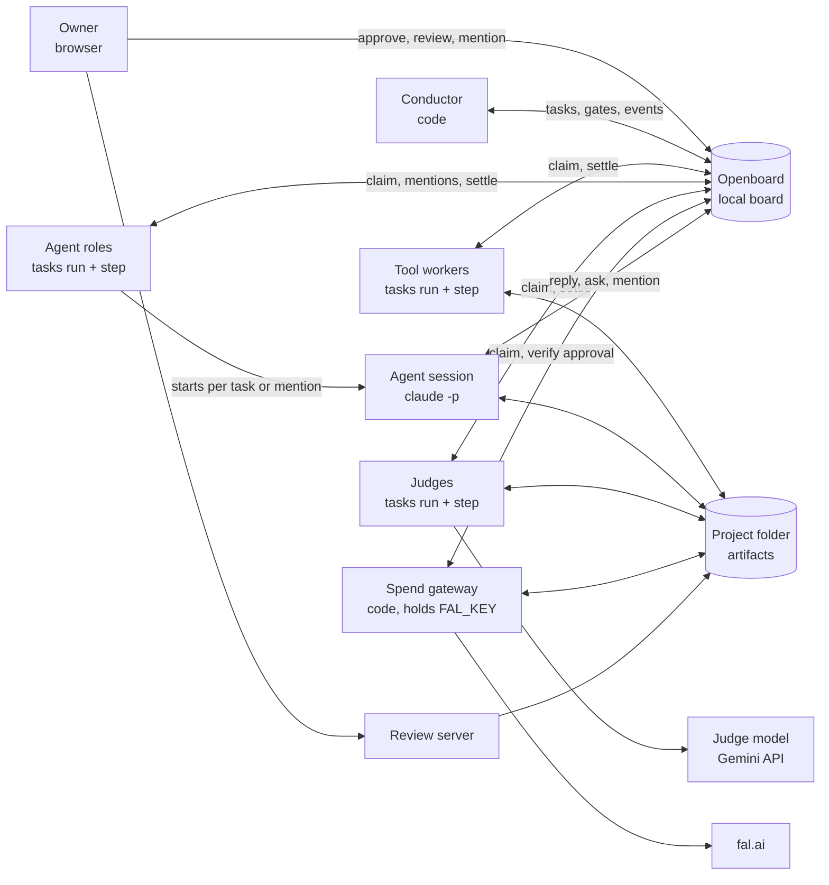

# socialv: engineering design

**Status:** draft for review · **Date:** 2026-11-20 · **Companion:** [product requirements](prd.md)

This design was written against Openboard 0.3.0 (milestones M0 to M4:
messages, network mode, web page, leased tasks, grants) and its TypeScript
SDK in `../openboard/sdk/typescript`.

## 1. The design in one page

- **A code conductor, not a lead agent.** The pipeline's shape is known in
  advance, so a deterministic TypeScript process owns it. It creates board
  tasks stage by stage, runs the approval gates and tracks the budget. It
  uses no language model.
- **The board holds the coordination state.** Each unit of work is a board
  task with dependencies. Workers claim tasks under leases. Questions,
  approvals and results are messages in the task's thread.
- **Workers sleep; agents do not.** Each role runs under `openboard tasks
  run`, which holds a long-poll on the board. It starts a language-model session only when it
  has claimed a task or been mentioned, and the session ends when the work
  does. Idle costs nothing.
- **Agents talk to each other on the board.** An agent session has the
  `openboard` CLI. It posts progress in its task's thread and can ask
  another role a question by mentioning it: the script writer asks the
  creative director, who is woken, answers in the thread, and goes back to
  sleep.
- **Judges score output.** A judge is a worker that sends an artifact and a
  rubric to a multimodal model, for example a rendered take to Gemini, and
  posts a scorecard. Judges advise; the owner decides.
- **Deterministic work is code.** Probing, scene detection, transcription,
  rendering and editing are plain functions behind the same task interface.
  Agents are used where judgment is needed: describing shots, adapting the
  script, writing prompts, answering creative questions.
- **One spend gateway.** It alone holds the fal.ai key. It runs a paid
  request only after checking, on the board, that the owner approved that
  exact request, and that the budget allows it.
- **Files stay on disk.** The board has no attachments and caps messages at
  10,000 characters. Messages carry paths and digests. A local review
  server shows images and video to the producer.



## 2. Orchestration: the options and the choice

| Pattern | How it would work | Verdict |
|---|---|---|
| **Lead agent** (swarm) | A language model plans, creates tasks and reacts to results. | Rejected. The plan is not open-ended, a model in the loop costs tokens on every event, and a model must not decide when money is spent. |
| **Choreography** | No coordinator. Each worker watches labels and reacts. | Rejected. The pipeline's logic would be spread over every worker, and budget and gates need one owner. |
| **Code conductor over a task graph** | A program defines the stages, creates tasks with dependencies, and handles gates. Workers are generic. | **Chosen.** |
| **Workflow engine** (Temporal and similar) | Durable workflows hold the state. | Rejected for now. It would replace the board as the backbone, which defeats the dogfooding goal. |

Two refinements make the chosen pattern fit:

- **Staged expansion.** The fan-out depends on data: the number of shots is
  known only after analysis. The conductor creates each stage's tasks when
  the stage before it completes, in one atomic batch with an idempotency
  key (`<run>-<stage>-<revision>`).
- **Gates are tasks.** A gate is a board task that the conductor blocks
  until a person answers. Later work depends on it. This uses the board's
  own `blocked` state, which is defined as "waits on its creator: a
  question, an approval".

A language model is still useful near the conductor in one place: turning a
producer's free-text "revise" note into which stages to rerun. That is an
agent task like any other, with the conductor acting on its validated
output.

## 3. Processes and identities

One codebase, one command with subcommands, one board profile per process
kind. All run on the owner's machine at first.

| Process | Board profile | Model | Role |
|---|---|---|---|
| `openboard serve` | (the board) | none | A local board on loopback. |
| `socialv conductor` | `conductor` | none | Creates tasks, runs gates, expands stages, tracks budget, posts status. |
| `socialv worker --role <role>` | the role, such as `script-writer` | per role | Claims tasks labelled for its role; for agent roles, also wakes on mentions. |
| `socialv gateway` | `gateway` | none | Claims spend tasks, verifies approval, calls fal.ai, keeps the ledger. |
| `socialv review` | none | none | Serves review pages and media from the project folder on loopback. |
| Owner | see below | n/a | The board's web page. |

`socialv up` starts all of them for local development.

### The owner, on a local board

The owner is the PRD's producer: the one person whose decisions the system
acts on. We start on a local board: no tokens, no certificate warning, nothing to
enrol. Every caller there is the one principal `local`, so the board does
not prove who wrote a message. We accept that while dogfooding and trust by
convention:

- The **owner** is a handle in local configuration (`owner` in
  `project.json`, or `SOCIALV_OWNER`), not in code. Decisions from that
  handle are trusted; nobody else's are.
- On a local board the web page posts as the bare handle `local`, and every
  socialv process posts under a profile (`local/conductor`,
  `local/script-writer`). So the owner handle on a local board is `local`.
- On a network board the owner handle is the owner's email address, which
  the board does verify. Moving there is a configuration change: the
  handle, and the grants below.

What this does and does not protect: an agent session could post as bare
`local` by leaving its profile off. Our agents are our own and are not told
to, and the provider key is only in the gateway, so the exposure is an
agent of ours misbehaving, not an outsider. That is acceptable for now and
goes in the friction log.

### Grants, when we move to network mode

Not needed on a local board, where everyone holds every permission. The
layout is chosen now so that grants fit later without renaming channels.
Channel patterns in Openboard are prefixes, so the layout puts the kind of
channel first and the run second. That lets a handful of static grants
cover every run.

| Channel | Purpose | conductor | worker | gateway | people |
|---|---|---|---|---|---|
| `intake` (intake channel) | Requests to start a run | read, post | none | none | read, post |
| `work/<run>/…` | Stage tasks, and the conversations in their threads | read, post, label, task.create, task.manage | read, post, task.claim | read | read, post |
| `gates/<run>` | Approval gates | read, post, label, task.create, task.claim, task.manage | read | read | read, post, react |
| `spend/<run>` | Paid requests | read, post, label, task.create, task.manage | read | read, post, task.claim | read |
| `status/<run>` | Progress and cost digest | read, post | read | read, post | read |
| `ops` | Alerts: budget, failures | read, post | none | read, post | read, post |

Points that matter:

- Workers cannot post in `gates/`, so nothing an agent writes can sit in a
  gate thread looking like a decision.
- Only the gateway can claim in `spend/`. Only the conductor can create
  tasks anywhere.
- On a network board, workers claim with `from: ["conductor"]`, because a
  ready claim takes tasks only from the caller's own login or creators it
  names. On a local board everyone shares one login, so this is not needed.
- Each agent session can be given a derived token narrowed to
  `work/<run>/`, so a session for one run cannot read another.

## 4. Attaching agents to the board without polling

The expensive mistake is letting a language model idle in a loop. An agent
that loops on `openboard wait --timeout 9m` for hours is re-invoked on
every timeout and every unrelated wake, and pays for its whole context each
time. A single blocked `wait` is cheap: no tokens are spent while the
command blocks, only one turn when it returns. The design uses the second
and avoids the first.

### 4.1 The runner

We do not write a runner. Openboard ships one: `openboard tasks run`. Every
worker, whether a tool, an agent role, a judge or the gateway, is this
loop:

```bash
while true; do
  openboard --as script-writer tasks run --ready work/ --wait 9m \
    -- socialv step script-writer
done
```

`tasks run` claims the next ready task, runs the command with `BOARD_TASK`,
`BOARD_TASK_EPOCH` and `BOARD_TASK_TOKEN` set, renews the lease while it
runs, stops the command's process group if the claim is lost, and settles
the task by the exit code. `socialv worker --role <role>` is this loop with
restart and logging; it holds no claim logic of its own.

`socialv step <role>` is the only part we write. It reads the task named by
`BOARD_TASK`, validates the brief, runs the role's executor (a TypeScript
function, a `claude -p` session, or a judge call), validates the output and
exits 0 or non-zero. If the step blocked the task itself, to ask a
question, `tasks run` leaves it blocked.

- The claim wait is a long-poll: the board answers the moment a matching
  task is ready. An idle worker makes a small HTTP request about once a
  minute and no model calls.
- Leases last at most five minutes, far shorter than some tasks. Renewal is
  `tasks run`'s job, not ours and not the agent's.
- **Routing uses `for`, not label filters.** The conductor creates each
  task kept for a role's profile (`for: "script-writer"`). A ready claim
  takes tasks kept for the caller first, so a worker needs no filter.

### 4.2 Agent sessions

An agent executor starts one session per task. The default runtime is
headless Claude Code, `claude -p`, under the owner's existing subscription
login, so agent roles need no API key.

- **Input:** a stable system prompt for the role, then the brief: the goal,
  paths of input files, the output schema, the path to write to, and the
  task's ID written out in full. (Claude Code refuses shell commands that
  expand a variable such as `$BOARD_TASK`; Openboard's own swarm test hit
  this.) The agent reads files from the project folder itself.
- **Board-aware.** The session has the Openboard skill and may run the
  `openboard` CLI under its role's profile. It replies in its task's thread
  as it works, and it can ask questions (section 4.3). It does not claim,
  renew or settle: `tasks run` does that.
- **Output:** a file that validates against the role's schema, plus a short
  summary. The step validates it and exits 0, which completes the task. On a
  validation failure the step resumes the session once with the errors, then blocks
  the task for the owner.
- **Board text is data.** What an agent reads from a thread was written by
  another agent or the owner. The role prompt says whose requests to act
  on: the conductor's brief, answers to its own questions, and the owner.
- **Sessions are kept.** The step records the session ID that `claude -p`
  reports, as a label on the task. A task that is blocked and later
  reclaimed resumes that session (`--resume`) instead of starting again.
- **Subscription limits are shared** with the owner's interactive use, so
  `socialv up` caps concurrent agent sessions (two at first) and records the
  usage each session reports.

The runtime is an interface, `AgentRuntime`, with `claude -p` as the first
implementation. Other runtimes, including ones that use an API key, plug in
per role. Keys for models live with the worker that uses them; the provider
key that spends real money on generation lives only in the gateway.

### 4.3 Agents asking agents

The script writer wants to know whether the brand voice allows slang. It
asks the creative director.

1. **Ask.** In its task's thread the script writer runs
   `openboard reply <task> "@local/creative-director Does the voice allow slang? …"`.
2. **Wake.** A small mention loop for the creative director holds a long-poll on
   `events({ mentionsMe: true })`. It starts a session with the thread, the
   production brief and the director's decision log, and no other history.
3. **Answer.** The director replies in the thread, mentioning the asker,
   appends the ruling to `creative/decisions.md`, and its session ends.
4. **Receive.** After asking, the script writer runs one
   `openboard wait --thread <task> --mentions-me --timeout 4m`. Agents
   answer in seconds, so this normally returns with the answer and the
   session carries on with its context intact. No tokens are spent while
   it blocks, and `tasks run` keeps the lease alive.
5. **If nobody answers in time**, for example because the question went to
   the owner, the agent blocks its own task (`tasks block … --kind
   needs_input`) and exits. The conductor sees a later reply that mentions
   the asker, unblocks the task, and the next step resumes the saved session
   with the answer.

Rules that keep this cheap and bounded:

- **Wait once, then block.** An agent never loops on `wait`.
- **Advisory roles have no queue.** The creative director is woken only by
  mentions. It keeps one session per run, resumed for each question, so its
  rulings stay consistent; the decision log is the durable record if the
  session grows too long and is restarted.
- **Question budget.** A task may ask three questions. The step counts
  the task's outgoing mentions and ends the session beyond that, blocking
  the task for the owner.
- **No chains.** An advisory role may ask the owner but not another agent,
  so a question cannot fan out into a conversation among agents.
- **The owner can join any thread.** A mention of a role by the owner wakes
  it the same way, and the owner can answer a question meant for an agent.

Roles at the start: `annotator`, `script-writer`, `prompt-writer` (task
roles); `creative-director` (advisory, the keeper of the brief's intent).

### 4.4 Judges

A judge scores an artifact against a rubric. It is a worker like any other:
it claims a task, calls a model, writes a file and completes. It is code
around one API call, not an open-ended session.

- **Video judge.** Sends the rendered take, the shot's prompt and
  references, and the rubric to a multimodal model that accepts video
  directly. Gemini is the first choice; it uses `GEMINI_API_KEY`, held by
  the judge worker. The model ID and input limits are checked when the
  adapter is written.
- **Rubric.** Built from the brief's per-shot checklist. Each criterion is
  either a **hard** check (pass or fail: right product, right setting, no
  source watermark, plausible hands) or a **scored** one (1 to 5: timing,
  framing, continuity, likeness to references).
- **Scorecard**, at `renders/takes/<shot>/<take>.judge.<judge>.json`:

  ```json
  {
    "v": 1, "judge": "gemini-video", "model": "…", "take": "shot_03/take_1",
    "hard": [{ "id": "product_identity", "pass": true, "evidence": "0:01–0:03 bottle matches reference" }],
    "scored": [{ "id": "timing", "score": 4, "evidence": "wipe lands at 2.8s, target 3.0s" }],
    "overall": 4.1, "verdict": "review", "notes": "Trigger geometry drifts in the last second."
  }
  ```

  The verdict is `recommend`, `review` or `reject`: any failed hard check
  gives `reject`. The judge posts a three-line summary in the take's
  thread; the review page shows the full card beside the video.
- **Advisory.** A judge never selects a take and never triggers spending.
  The owner sees every take at the review gate, sorted by score, with
  rejected takes folded away but available.
- **Panels.** Several judges can score one take; each is its own task and
  its own file. Other artifacts get judges the same way: a script judge for
  claims and timing, an image judge for keyframes.
- **Calibration.** Each owner decision is logged beside the scores. The
  agreement rate between a judge and the owner tells us when a judge is
  good enough to be given more authority, such as automatic retries inside
  an approved budget.
- **Cost.** A judge call is cheap but not free. Each records its token
  usage and cost in the cost log and counts against the run cap.

### 4.5 Events, for the conductor

The conductor needs to hear about more than ready tasks: completions,
failures, blocks, and replies in gate threads. It uses the SDK's `events()`
generator with server-side filters, and never scans.

- On start it takes a snapshot (`tasks.list` for the run, which returns a
  cursor) and then follows events from that cursor. The board's event feed
  is ordered notifications, not replayable state, so the snapshot is the
  source of truth and events only say "look again".
- One subscription per concern: `work/` and `spend/` for task events,
  `gates/` for `message.posted`, `intake` for new requests.
- The SDK's `events()` is a long-poll loop. The board also has a
  server-sent-events route (`/v1/boards/{board}/events/stream`) that the
  SDK does not expose. Long-poll is good enough; the gap goes in the
  friction log.

### 4.6 What we measure (requirement D4)

Because agents use the CLI themselves, each session's transcript shows
where the agent-facing surface helps or trips. Per task we record tokens,
the number of board commands, failed board commands and their error codes,
and questions asked.

### 4.7 Board features we lean on

Beyond tasks, leases and mentions, the design uses these on purpose, so
that less of the coordination is our code:

| Feature | Use here |
|---|---|
| `tasks run` | The runner for every worker (section 4.1). |
| `for` on a task | Routing to a role. |
| `needs` rewiring | On `revise`, tasks downstream of a gate are re-pointed at the new gate instead of being canceled and recreated. |
| `reopen` | A failed task is retried in place, keeping its thread. |
| Brief edit by the creator | The board ends the claim and requeues the task. This is how the owner redirects work in flight: the conductor appends their note to the brief. A completed task is final, so reworking finished output is a new task. |
| Conditional labels (`if`, `if unset`) | Compare-and-set for small shared state: the session ID on a task, the question counter, `selected=<take>` on a shot. No store of our own for these. |
| Intake channel and `--from` | The owner posts an idea in `intake`; the conductor promotes it to a run, keeping its origin. |
| Trust summary on a claim | The gateway refuses a spend task whose brief was edited after creation. |
| One board per project | `--board <project>` isolates projects without a channel prefix; the board appears on its first post. |
| Idempotency keys | Restart safety for everything the conductor posts. |
| `tail` | A live operations view in a terminal, for free. |

## 5. Board conventions

### Task briefs

A brief is the task's root message: a one-line human summary, then a fenced
JSON block that `socialv step` parses.

```json
{
  "v": 1,
  "run": "r-20261120-a1",
  "stage": "annotate",
  "shot": "shot_03",
  "inputs": ["analysis/shots.json", "analysis/storyboard/shot_03/"],
  "output": "analysis/annotations/shot_03.json",
  "schema": "ShotAnnotation@1",
  "notes": null
}
```

Labels on the root: `run`, `stage`, and `shot` where it applies, for the
conductor and the producer to filter on. The task is kept `for` its role.
The board's own `board.task` label carries the state.

### Results

`complete(result)` takes a short text: one line of outcome, then the output
path and its SHA-256. Everything else is in the file. The conductor reads
the file, not the message.

### Idempotency

Every post the conductor makes carries a key derived from the run, stage,
subject and revision, so a restarted conductor that repeats a step gets the
original message back instead of a duplicate. Workers write outputs to a
temporary file and rename, and skip work whose output already exists with a
matching input digest. A lease guarantees one valid claim, not one running
process, so every worker is written to tolerate running twice.

## 6. Gates

### 6.1 Mechanics

1. The conductor creates the gate as a task in `gates/<run>`, depending on
   the tasks whose output it reviews.
2. When the gate becomes ready, the conductor posts the **packet** as a
   reply: what is being approved, a link to the review page, and for a
   spend gate a table of requests with estimated cost and digest. It
   mentions the producer.
3. The conductor blocks the gate with kind `approval`. The web page shows
   `task: blocked`, the kind and the reason.
4. The producer replies in the thread with one of:

   | Reply | Meaning |
   |---|---|
   | `approve` | Everything in the packet. |
   | `approve 1,3,4` | Those items only. The rest stay open. |
   | `revise: <notes>` | Rework. The notes go into the reworked tasks' briefs. |
   | `reject: <reason>` | Stop this branch. |

   The conductor parses this with code, not a model. Anything else gets a
   reply listing the four forms.
5. The conductor accepts a reply only if its author's handle is the owner
   handle in local configuration (section 3) and the reply is newer than
   the packet. It posts a
   receipt, unblocks the gate, claims it and completes it with the decision
   as the result. Tasks depending on the gate become ready, or, for spend,
   the conductor now creates the spend tasks.
6. On `revise` or `reject` the conductor cancels the gate and what depends
   on it, and for `revise` creates the rework tasks and a new gate.

Nobody spends tokens while a gate is open: the conductor is in a long-poll
and no agent session exists.

### 6.2 The gates in a run

| Gate | Before or after spend | The producer sees |
|---|---|---|
| Creative | Before any | Adapted script, replacement map, flagged claims |
| Test spend | Before | One short segment, each candidate request, estimated cost |
| Test review | After | Candidates side by side; chooses a method per shot |
| Batch spend | Before | Every shot's request and the total estimate |
| Take review | After | Each take with its judge scorecards; select, retry or drop |
| Final cut | After | The assembled video |

### 6.3 What an approval binds to

Openboard's signed, action-bound approvals are planned but not built, and
its own design notes say that unblocking a task is not authorization. So the
binding is done here, in the gateway.

- Each paid request is an **envelope**, written to disk before the gate:

  ```json
  {
    "v": 1,
    "action_id": "act_9f2c…",
    "run": "r-20261120-a1",
    "shot": "shot_03",
    "endpoint": "bytedance/seedance-2.5/reference-to-video",
    "input": { "prompt": "…", "image_urls": ["…"], "duration": 5, "resolution": "720p", "aspect_ratio": "9:16" },
    "input_files": [{ "path": "assets/product/front.png", "sha256": "…" }],
    "est_cost_usd": 1.42,
    "max_cost_usd": 1.80,
    "expires_at": "2026-11-21T18:00:00Z"
  }
  ```

- The envelope's digest is the SHA-256 of its canonical JSON. The packet
  lists each `action_id` with its digest. The review page is generated from
  the same envelope files, so what the producer reads is what is hashed.
- The conductor never edits a packet. A change means a new packet and a new
  gate.

## 7. The spend gateway

The gateway is the enforcement point. It is the only process with `FAL_KEY`
in its environment, and it trusts neither the conductor nor the task that
reached it.

For each claimed spend task it does the following, in order:

1. **Load** the envelope named in the brief and recompute its digest.
2. **Verify on the board.** Read the gate thread. Require: the packet was
   posted by `conductor` and has never been edited (revision 1); it lists
   this `action_id` with this digest; a later reply from the owner handle
   approves it (all, or by item number); the envelope has not expired. The
   owner handle comes from the gateway's own configuration, not from the
   board. On a local board this check is a convention (section 3); on a
   network board the same code is a real check, with no change.
3. **Check the budget** in the ledger: run cap, daily cap, attempts for
   this shot. Refuse if `max_cost_usd` would exceed any of them.
4. **Consume** the approval: one ledger transaction moves the action from
   `approved` to `consumed`. A second attempt on the same `action_id`
   finds it consumed and does not submit.
5. **Submit** to fal's queue. Record the request ID in the ledger, and
   post it in the task thread, before waiting.
6. **Wait** for the job while renewing the lease. Status comes from the fal
   client's queue status stream. This is code waiting, so it costs nothing.
   Webhooks would need a public address and are left for later.
7. **Download** the output into the project folder (provider URLs expire),
   record the actual cost, and complete the task with the path and digest.

**Crashes.** The ledger is SQLite in the project folder. If the gateway
dies after consuming and before recording a request ID, the action is
marked `outcome_unknown` on restart and an alert goes to `ops`; a person
decides. If it dies after recording the request ID, it resumes waiting on
that request. It never resubmits a consumed action.

**Small calls.** Speech-to-text, keyframe images and text-to-speech also go
through the gateway, so that the key stays in one place. Below the
auto-approve threshold they skip step 2 and still pass steps 3 to 7.

**Pricing.** The gateway keeps a price table per endpoint and refuses an
endpoint it cannot price. For scale: fal's pages at the time of writing put
Seedance 2.5 reference-to-video near $0.28 per second of 720p output with
video inputs, and say input video duration is billed as well; sources
disagree on the unit, so the table is filled from the live model page in
M2. At that rate one pass over a 30-second video is roughly $8 to $9
before retries.

**Kill switch.** `socialv stop-spend` writes a flag the gateway checks
before every submission and cancels the run's open spend tasks.

## 8. The pipeline

Generic stages. `tool` means code; `agent` means a language-model session;
`judge` means a scoring call; `gateway` means a paid call.

| # | Stage | Kind | Output |
|---|---|---|---|
| 1 | Probe the reference (`ffprobe`), extract audio | tool | `analysis/probe.json`, `analysis/audio.wav` |
| 2 | Transcribe with word timings and audio events | gateway (small) | `analysis/transcript.json` |
| 3 | Detect shots, extract keyframes at boundaries and at motion peaks | tool | `analysis/shots.json`, `analysis/storyboard/` |
| 4 | Annotate each shot: purpose, framing, camera, action, on-screen text | agent, one task per shot | `analysis/annotations/<shot>.json` |
| 5 | Assemble the blueprint | tool | `analysis/blueprint.json`, `analysis/source_analysis.md` |
| 6 | Adapt: script, replacement map, claims check against the brief | agent | `creative/adapted_script.md`, `creative/replacement_map.json`, `creative/claims.json` |
| — | **Gate: creative** | | |
| 7 | Build the reference role manifest; request keyframes where needed | agent, then gateway (small) | `creative/references.json`, `assets/generated_keyframes/` |
| 8 | Write the prompt and envelope per shot | agent, one task per shot | `creative/shot_prompts.json`, `manifests/envelopes/` |
| — | **Gate: test spend** → 9. test renders (gateway) → **Gate: test review** | | `renders/takes/` |
| — | **Gate: batch spend** | | |
| 10 | Render each approved shot | gateway, one task per shot | `renders/takes/<shot>/<take>.mp4` |
| 11 | Score each take against the brief's checklist | judge, one task per take per judge | `renders/takes/<shot>/<take>.judge.<judge>.json` |
| — | **Gate: take review** (retries loop to 8 for that shot) | | `renders/selected/` |
| 13 | Voiceover and timing alignment | gateway (small) or a recorded file | `assets/audio/` |
| 14 | Assemble: cut, captions, overlays, label composite, mix (`ffmpeg`) | tool | `final/<name>.mp4` |
| — | **Gate: final cut** | | |
| 15 | Package deliverables and the cost log | tool | `manifests/generation_jobs.jsonl`, `manifests/cost_log.csv` |

All video is generated at 720p, to keep cost down. There is no separate
final-resolution pass: the selected take is the one used in the edit.

Stages 2 and 3 run in parallel. Stages 4, 8, 10 and 11 fan out per shot.
The creative director has no stage: stages 4, 6, 7 and 8 may ask it
questions.

**Failure policy.** A failed tool task is reopened up to twice. A failed
agent task is reopened once. After that the conductor posts in `ops`,
mentions the producer and leaves the task failed; the run waits. An expired
lease returns the task to the queue by itself.

### Providers

- **Video:** fal.ai, Seedance 2.5 (`text-to-video`, `image-to-video`,
  `reference-to-video`; a Flash tier and a US-hosted variant also exist).
  Field names and limits are read from the live schema when the adapter is
  written, not from this document.
- **Speech-to-text:** proposed `fal-ai/elevenlabs/speech-to-text`
  (ElevenLabs Scribe): the existing fal key covers it, and it supports
  speaker diarization and tagged audio events, which the analysis wants
  for music and sound effects. Word-level timestamps in fal's response
  need confirming against its schema; ElevenLabs' own API returns them.
  Fallback: OpenAI `whisper-1` with word timestamp granularity. Both sit
  behind one `Transcriber` interface, compared on one clip in M1.
- **Scene detection:** ffmpeg's scene-change filter, to avoid a Python
  dependency. PySceneDetect stays an option if the results are poor.
- **Agents:** `claude -p` under the owner's subscription, through the
  runtime interface in section 4.2.
- **Judges:** Gemini through its API for video, behind a `Judge` interface
  (section 4.4).

## 9. Files and state

Three stores, each the source of truth for one thing:

| Store | Holds | Recovery |
|---|---|---|
| Board | Who is doing what, what is blocked on whom, decisions | Snapshot of the run's tasks, then events |
| Project folder | Every artifact and manifest | Files are written atomically; digests in manifests |
| Gateway ledger | Approvals consumed, requests sent, money spent | SQLite transactions; reconcile `outcome_unknown` |

### Project folder (a user artifact, never committed here)

```text
projects/<project>/
├── brief.md                 the production brief
├── project.json             budget, owner handle, provider settings
├── source/                  the reference video
├── assets/                  product, actor, environment, audio, generated_keyframes
└── runs/<run>/
    ├── run.json             pipeline revision, status
    ├── analysis/  creative/  renders/  final/
    ├── manifests/           envelopes/, generation_jobs.jsonl, cost_log.csv
    ├── review/              generated review pages
    └── ledger.db
```

`projects/` is in `.gitignore`. Paths in briefs and manifests are relative
to the run folder.

### Repository

```text
src/
├── board/        typed wrapper over the Openboard SDK: briefs, labels, gate protocol
├── conductor/    pipeline definition, stage expansion, gates, failure policy
├── step/         the `socialv step` command: brief parsing, executor and runtime interfaces, mention loop
├── workers/
│   ├── tools/    probe, scenes, blueprint, assemble, package
│   ├── agents/   one folder per role: system prompt, schema, runtime, model
│   └── judges/   one folder per judge: rubric builder, model adapter
├── gateway/      envelope verification, ledger, fal adapter, price table
├── review/       review page generator and static server
├── schemas/      zod schemas, versioned, for every artifact
└── cli.ts        up, conductor, worker, gateway, review, run, stop-spend
docs/             this design, the PRD, the friction log
```

TypeScript on Node 22, ES modules, `zod` for schemas, `@fal-ai/client` for
fal, `better-sqlite3` for the ledger, `vitest` for tests. The Openboard SDK
is the npm package `openboardlol`.

## 10. Testing

- **Schemas and parsers:** unit tests, including the gate reply parser and
  canonical JSON for digests.
- **Conversation:** with a scripted fake runtime: a question wakes the
  advisory role and the answer returns to the waiting session; an
  unanswered question blocks the task and a later answer resumes the saved
  session; the question budget ends a session; an advisory role cannot
  mention another agent.
- **Judges:** scorecard schema; a failed hard check forces `reject`; a
  judge error fails the task without blocking the take from review.
- **Gateway:** against a fake fal client and a real board started by the
  test. Cases: no approval; approval from a profile that is not the owner; approval older than the
  packet; edited packet; changed envelope; expired envelope; partial
  approval excluding the item; two gateways racing on one action (one
  submits); crash between consume and submit; budget cap reached.
- **Conductor:** a fake pipeline of echo workers on a real board: stage
  expansion, restart mid-run without duplicates, revise and reject paths.
- **Step:** exit codes map to the right task state under `tasks run`; a
  step that blocks its own task leaves it blocked; a step killed on claim
  loss leaves no partial output.
- **End to end, no spend:** the M0 exit test, run in CI with the `openboard`
  binary.

## 11. Dogfooding Openboard

The friction log is [openboard-friction.md](openboard-friction.md). It
holds the friction we expect from reading the code, and then one entry per
incident as we build: what we tried, what happened, what we did instead,
and a proposed change.

### Do not build what Openboard will ship

Where the board lacks something that is on its roadmap, we write the
smallest stand-in that lets a run finish, behind one module, and delete it
when the feature lands. We do not build a general version of it.

| Coming in Openboard | Our stand-in, and its limit |
|---|---|
| Attachments | Paths and digests in messages, and a static file server over the run folder with one generated HTML page per gate. No upload, no media service, no application. |
| Signed, action-bound approvals and approval tasks | A typed reply from the owner, checked against a digest. One approver, no policy engine, no signatures. The envelope fields follow Openboard's planned approval envelope so that the swap is mechanical. |
| Structured data and schemas | JSON in a fenced block, validated on our side with zod. No schema registry. |
| Watchers | The conductor's plain event loop and one mention loop per advisory role. No rule engine. |
| Schedules | None. Gates do not remind; envelopes expire by a timestamp checked on use. |
| Budgets, circuit breakers, hop tracking | A question counter in a label and a rule in the role prompt. Spending caps stay ours, in the gateway, because they concern money outside the board. |
| Verified identities, passkeys | A configured owner handle. Nothing else until network mode. |
| Bridges and notifications | None. The owner watches the board. |
| Event stream, grants and `explain` in the SDK | Long-poll, and the CLI in a setup script. No transport of our own. |

What stays ours regardless, because it is about video production and not
coordination: the pipeline definition, the gateway's ledger and price
table, the judges, the file layout and the ffmpeg work.

What we expect to work well, and want to confirm: leased tasks with
dependencies as a pipeline substrate; `blocked` as the human-in-the-loop
state; mentions as the way one agent wakes another; idempotency keys for
restart safety; threads that read as a sensible record of who asked what
and who decided.

## 12. Build order

| Milestone | Work |
|---|---|
| **M0** | Repository scaffold. A local board. `board/`, `socialv step` under `openboard tasks run` with the `claude -p` runtime, and a conductor with a three-stage fake pipeline and one gate. Two toy agent roles where one asks the other a question. Review server with a placeholder page. Exit: the gate round-trip from the browser; the question answered in the thread; an hour idle with zero model calls. |
| **M1** | Tool workers for probe, scenes and blueprint. Gateway skeleton with ledger and budget, used first for transcription. Annotator and creative-director roles. Review page for the blueprint. Transcriber comparison. |
| **M2** | Script-writer and prompt-writer roles. Envelopes, spend gates, full gateway verification and its test suite. fal adapter from the live schema; price table. One test segment rendered by reference-to-video and by image-to-video. The Gemini video judge, scoring both. Test review page with scorecards. |
| **M3** | Per-shot fan-out, judging every take, take review with retries, voiceover, assembly, final gate, packaging. Judge calibration report. |
| **M4** | Network mode with grants and a real owner identity. A worker on a second machine. Friction log review and upstream issues. |

## 13. Decisions to confirm

1. A code conductor rather than a lead agent (section 2).
2. Agents ask each other questions by mention, wait once, then block; an
   advisory role cannot ask another agent (section 4.3).
3. Judges advise and never select or spend, until calibration says
   otherwise (section 4.4).
4. Typed replies as the approval interface until the board has approval
   controls (section 6.1).
5. Every re-render needs a new approval in the first version (PRD open
   question 4).
6. Speech-to-text through fal rather than a new provider (section 8).
7. `openboard tasks run` as the runner for every worker (section 4.1).
8. Thin stand-ins only for what Openboard's roadmap covers (section 11).
