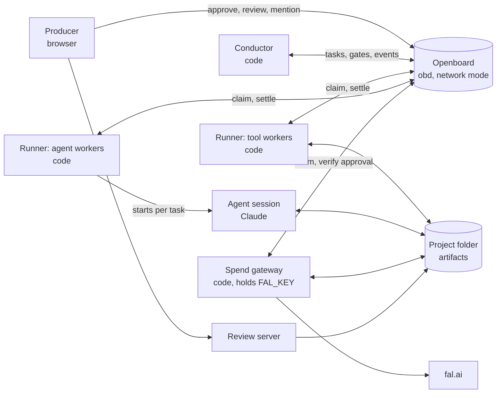

# socialv: engineering design

**Status:** draft for review · **Date:** 2026-11-20 · **Companion:** [product requirements](prd.md)

This design was written against Openboard 0.3.0 (milestones M0 to M4:
messages, network mode, web page, leased tasks, grants) and its TypeScript
SDK in `../openboard/sdk/typescript`.

## 1. The design in one page

- **A code conductor, not a lead agent.** The pipeline's shape is known in
  advance, so a deterministic TypeScript process owns it. It creates board
  tasks stage by stage, runs the approval gates and tracks the budget. It
  uses no language model.
- **The board holds the coordination state.** Each unit of work is a board
  task with dependencies. Workers claim tasks under leases. Questions,
  approvals and results are messages in the task's thread.
- **Runners sleep; agents do not.** A small process per role holds a
  long-poll on the board. It starts a language-model session only when it
  has claimed a task, and the session ends when the task does. Idle costs
  nothing.
- **Deterministic work is code.** Probing, scene detection, transcription,
  rendering and editing are plain functions behind the same task interface.
  Agents are used where judgment is needed: describing shots, adapting the
  script, writing prompts, screening takes.
- **One spend gateway.** It alone holds the fal.ai key. It runs a paid
  request only after checking, on the board, that a person approved that
  exact request, and that the budget allows it.
- **Files stay on disk.** The board has no attachments and caps messages at
  10,000 characters. Messages carry paths and digests. A local review
  server shows images and video to the producer.



## 2. Orchestration: the options and the choice

| Pattern | How it would work | Verdict |
|---|---|---|
| **Lead agent** (swarm) | A language model plans, creates tasks and reacts to results. | Rejected. The plan is not open-ended, a model in the loop costs tokens on every event, and a model must not decide when money is spent. |
| **Choreography** | No coordinator. Each worker watches labels and reacts. | Rejected. The pipeline's logic would be spread over every worker, and budget and gates need one owner. |
| **Code conductor over a task graph** | A program defines the stages, creates tasks with dependencies, and handles gates. Workers are generic. | **Chosen.** |
| **Workflow engine** (Temporal and similar) | Durable workflows hold the state. | Rejected for now. It would replace the board as the backbone, which defeats the dogfooding goal. |

Two refinements make the chosen pattern fit:

- **Staged expansion.** The fan-out depends on data: the number of shots is
  known only after analysis. The conductor creates each stage's tasks when
  the stage before it completes, in one atomic batch with an idempotency
  key (`<run>-<stage>-<revision>`).
- **Gates are tasks.** A gate is a board task that the conductor blocks
  until a person answers. Later work depends on it. This uses the board's
  own `blocked` state, which is defined as "waits on its creator: a
  question, an approval".

A language model is still useful near the conductor in one place: turning a
producer's free-text "revise" note into which stages to rerun. That is an
agent task like any other, with the conductor acting on its validated
output.

## 3. Processes and identities

One codebase, one command with subcommands, one board identity per process
kind. All run on the producer's machine at first.

| Process | Board identity | Model | Role |
|---|---|---|---|
| `obd` | (the board) | none | Network mode, bound to loopback at first. |
| `socialv conductor` | `conductor` | none | Creates tasks, runs gates, expands stages, tracks budget, posts status. |
| `socialv worker --role <role>` | `worker` with profile `<role>` | per role | Claims tasks labelled for its role and runs the role's executor. |
| `socialv gateway` | `gateway` | none | Claims spend tasks, verifies approval, calls fal.ai, keeps the ledger. |
| `socialv review` | none | none | Serves review pages and media from the project folder on loopback. |
| Producer | their email address | n/a | The board's web page. |

`socialv up` starts all of them for local development.

**Why network mode from the start.** On a local board every caller is the
one principal `local`, so the board cannot tell a person from an agent and
an approval means nothing. In network mode the board stamps each message
with the identity of its token or browser session, and an agent token
cannot post as a person. The cost is a self-signed certificate warning in
the browser, accepted once.

### Grants

Channel patterns in Openboard are prefixes, so the channel layout puts the
kind of channel first and the run second. That lets a handful of static
grants cover every run.

| Channel | Purpose | conductor | worker | gateway | people |
|---|---|---|---|---|---|
| `intake` (intake channel) | Requests to start a run | read, post | none | none | read, post |
| `work/<run>/…` | Stage tasks | read, post, label, task.create, task.manage | read, post, task.claim | read | read, post |
| `gates/<run>` | Approval gates | read, post, label, task.create, task.claim, task.manage | read | read | read, post, react |
| `spend/<run>` | Paid requests | read, post, label, task.create, task.manage | read | read, post, task.claim | read |
| `status/<run>` | Progress and cost digest | read, post | read | read, post | read |
| `ops` | Alerts: budget, failures | read, post | none | read, post | read, post |

Points that matter:

- Workers cannot post in `gates/`, so nothing an agent writes can sit in a
  gate thread looking like a decision.
- Only the gateway can claim in `spend/`. Only the conductor can create
  tasks anywhere.
- Workers claim with `from: ["conductor"]`, because a ready claim takes
  tasks only from the caller's own login or creators it names.
- Later, each agent session can be given a derived token narrowed to
  `work/<run>/`, so a session for one run cannot read another.

## 4. Attaching agents to the board without polling

The expensive mistake is letting a language model wait. An agent that loops
on `openboard wait --timeout 9m` is re-invoked on every timeout and every
unrelated wake, and pays for its whole context each time.

### 4.1 The runner

A runner is about a hundred lines of code around the SDK:

```ts
import { board } from "openboard";

const b = board().as(role);                 // e.g. worker/annotator
for (;;) {
  const claim = await b.tasks.claim({
    channel: "work/", label: { role }, from: ["conductor"], wait: "30m",
  });
  if (!claim) continue;                     // nothing ready; no tokens spent
  const lease = keepRenewing(claim);        // every third of the lease
  try {
    const brief = parseBrief(claim.task.text);            // validated
    const out = await executor.run(brief, lease.signal);  // code or agent
    if (out.status === "needs_input") await claim.block(out.question, { kind: "needs_input" });
    else await claim.complete(summarize(out));
  } catch (err) {
    if (!isClaimLost(err)) await claim.fail(describe(err)).catch(() => {});
  } finally {
    lease.stop();
  }
}
```

- `tasks.claim` with `wait` is a long-poll: the board holds the request for
  up to 60 seconds and answers the moment a matching task is ready. The SDK
  repeats it. An idle runner makes about one small HTTP request a minute
  and no model calls.
- The runner, not the agent, renews the lease and settles the task. Leases
  last at most five minutes, far shorter than some tasks.
- If the claim is lost (canceled, brief edited, lease expired), the runner
  aborts the executor and does not settle.
- This is the same contract as `openboard tasks run`, in-process, so the
  executor can be a TypeScript function as easily as a subprocess.

### 4.2 Agent sessions

An agent executor starts one fresh session per task.

- **Input:** a stable system prompt for the role (cacheable), then the
  brief: the goal, paths of input files, the output schema, the path to
  write to. The agent reads files from the project folder itself.
- **Output:** a file that validates against the role's schema, plus a short
  summary. The runner validates, writes the manifest entry and posts the
  summary. On a validation failure the runner retries once with the errors,
  then blocks the task for a person.
- **Board-unaware by default.** The agent has no board tools and no board
  credentials. The runner speaks to the board for it. This saves the tokens
  of the skill file on every session, and means text on the board never
  reaches a model as anything but the brief the conductor wrote.
- **Questions.** An agent that needs an answer returns
  `{status: "needs_input", question}`. The runner posts the question and
  blocks the task. The conductor mentions the producer. When the producer
  replies, the conductor unblocks the task; the next claim resumes the
  saved session with the reply appended, rather than starting again.
- **Model per role.** A capable model for annotation, adaptation and prompt
  writing; a small one for screening takes and classifying revise notes.

The runtime sits behind an interface with two implementations: the Claude
Agent SDK for TypeScript, and headless Claude Code (`claude -p`) as a
subprocess. Which is the default is PRD open question 1.

### 4.3 Events, for the conductor

The conductor needs to hear about more than ready tasks: completions,
failures, blocks, and replies in gate threads. It uses the SDK's `events()`
generator with server-side filters, and never scans.

- On start it takes a snapshot (`tasks.list` for the run, which returns a
  cursor) and then follows events from that cursor. The board's event feed
  is ordered notifications, not replayable state, so the snapshot is the
  source of truth and events only say "look again".
- One subscription per concern: `work/` and `spend/` for task events,
  `gates/` for `message.posted`, `intake` for new requests.
- The SDK's `events()` is a long-poll loop. The board also has a
  server-sent-events route (`/v1/boards/{board}/events/stream`) that the
  SDK does not expose. Long-poll is good enough; the gap goes in the
  friction log.

### 4.4 Mentions, for ad-hoc requests

The producer may want to address a role directly in a thread ("@worker/writer
tighten line three"). Each agent runner also follows
`events({ mentionsMe: true })`. A mention from a person on the approver
list in a thread of the role's own task becomes a small follow-up task the
conductor creates; the runner does not act on the message directly. This
keeps one path for all work and keeps board text out of prompts unless the
conductor put it in a brief.

### 4.5 Board-native experiment (requirement D4)

For one role, in M4, run the agent the way Openboard's own guides do:
`openboard tasks run --ready work/ --label role=<role> -- <agent>` with the
skill file installed, the agent replying in its thread and blocking its own
task. Compare tokens per task, failure modes and how the thread reads to a
person. This tests the agent-facing surface that the default design
deliberately bypasses.

## 5. Board conventions

### Task briefs

A brief is the task's root message: a one-line human summary, then a fenced
JSON block the runner parses.

```json
{
  "v": 1,
  "run": "r-20261120-a1",
  "stage": "annotate",
  "shot": "shot_03",
  "inputs": ["analysis/shots.json", "analysis/storyboard/shot_03/"],
  "output": "analysis/annotations/shot_03.json",
  "schema": "ShotAnnotation@1",
  "notes": null
}
```

Labels on the root: `run`, `stage`, `role`, and `shot` where it applies.
Workers filter on `role`; the conductor and the producer filter on `run`
and `stage`. The board's own `board.task` label carries the state.

### Results

`complete(result)` takes a short text: one line of outcome, then the output
path and its SHA-256. Everything else is in the file. The conductor reads
the file, not the message.

### Idempotency

Every post the conductor makes carries a key derived from the run, stage,
subject and revision, so a restarted conductor that repeats a step gets the
original message back instead of a duplicate. Workers write outputs to a
temporary file and rename, and skip work whose output already exists with a
matching input digest. A lease guarantees one valid claim, not one running
process, so every worker is written to tolerate running twice.

## 6. Gates

### 6.1 Mechanics

1. The conductor creates the gate as a task in `gates/<run>`, depending on
   the tasks whose output it reviews.
2. When the gate becomes ready, the conductor posts the **packet** as a
   reply: what is being approved, a link to the review page, and for a
   spend gate a table of requests with estimated cost and digest. It
   mentions the producer.
3. The conductor blocks the gate with kind `approval`. The web page shows
   `task: blocked`, the kind and the reason.
4. The producer replies in the thread with one of:

   | Reply | Meaning |
   |---|---|
   | `approve` | Everything in the packet. |
   | `approve 1,3,4` | Those items only. The rest stay open. |
   | `revise: <notes>` | Rework. The notes go into the reworked tasks' briefs. |
   | `reject: <reason>` | Stop this branch. |

   The conductor parses this with code, not a model. Anything else gets a
   reply listing the four forms.
5. The conductor accepts a reply only if the board marks its author as
   kind `person`, the handle is on the approver list in local
   configuration, and the reply is newer than the packet. It posts a
   receipt, unblocks the gate, claims it and completes it with the decision
   as the result. Tasks depending on the gate become ready, or, for spend,
   the conductor now creates the spend tasks.
6. On `revise` or `reject` the conductor cancels the gate and what depends
   on it, and for `revise` creates the rework tasks and a new gate.

Nobody spends tokens while a gate is open: the conductor is in a long-poll
and no agent session exists.

### 6.2 The gates in a run

| Gate | Before or after spend | The producer sees |
|---|---|---|
| Creative | Before any | Adapted script, replacement map, flagged claims |
| Test spend | Before | One short segment, each candidate request, estimated cost |
| Test review | After | Candidates side by side; chooses a method per shot |
| Batch spend | Before | Every shot's request and the total estimate |
| Take review | After | Each take with the screening notes; select, retry or drop |
| Final-resolution spend | Before | Selected takes to render at final resolution, cost |
| Final cut | After | The assembled video |

### 6.3 What an approval binds to

Openboard's signed, action-bound approvals are planned but not built, and
its own design notes say that unblocking a task is not authorization. So the
binding is done here, in the gateway.

- Each paid request is an **envelope**, written to disk before the gate:

  ```json
  {
    "v": 1,
    "action_id": "act_9f2c…",
    "run": "r-20261120-a1",
    "shot": "shot_03",
    "endpoint": "bytedance/seedance-2.5/reference-to-video",
    "input": { "prompt": "…", "image_urls": ["…"], "duration": 5, "resolution": "720p", "aspect_ratio": "9:16" },
    "input_files": [{ "path": "assets/product/front.png", "sha256": "…" }],
    "est_cost_usd": 1.42,
    "max_cost_usd": 1.80,
    "expires_at": "2026-11-21T18:00:00Z"
  }
  ```

- The envelope's digest is the SHA-256 of its canonical JSON. The packet
  lists each `action_id` with its digest. The review page is generated from
  the same envelope files, so what the producer reads is what is hashed.
- The conductor never edits a packet. A change means a new packet and a new
  gate.

## 7. The spend gateway

The gateway is the enforcement point. It is the only process with `FAL_KEY`
in its environment, and it trusts neither the conductor nor the task that
reached it.

For each claimed spend task it does the following, in order:

1. **Load** the envelope named in the brief and recompute its digest.
2. **Verify on the board.** Read the gate thread. Require: the packet was
   posted by `conductor` and has never been edited (revision 1); it lists
   this `action_id` with this digest; a later reply by a `person` on the
   approver list approves it (all, or by item number); the envelope has not
   expired. The approver list comes from the gateway's own configuration,
   not from the board.
3. **Check the budget** in the ledger: run cap, daily cap, attempts for
   this shot. Refuse if `max_cost_usd` would exceed any of them.
4. **Consume** the approval: one ledger transaction moves the action from
   `approved` to `consumed`. A second attempt on the same `action_id`
   finds it consumed and does not submit.
5. **Submit** to fal's queue. Record the request ID in the ledger, and
   post it in the task thread, before waiting.
6. **Wait** for the job while renewing the lease. Status comes from the fal
   client's queue status stream. This is code waiting, so it costs nothing.
   Webhooks would need a public address and are left for later.
7. **Download** the output into the project folder (provider URLs expire),
   record the actual cost, and complete the task with the path and digest.

**Crashes.** The ledger is SQLite in the project folder. If the gateway
dies after consuming and before recording a request ID, the action is
marked `outcome_unknown` on restart and an alert goes to `ops`; a person
decides. If it dies after recording the request ID, it resumes waiting on
that request. It never resubmits a consumed action.

**Small calls.** Speech-to-text, keyframe images and text-to-speech also go
through the gateway, so that the key stays in one place. Below the
auto-approve threshold they skip step 2 and still pass steps 3 to 7.

**Pricing.** The gateway keeps a price table per endpoint and refuses an
endpoint it cannot price. For scale: fal's pages at the time of writing put
Seedance 2.5 reference-to-video near $0.28 per second of 720p output with
video inputs, and say input video duration is billed as well; sources
disagree on the unit, so the table is filled from the live model page in
M2. At that rate one pass over a 30-second video is roughly $8 to $9
before retries.

**Kill switch.** `socialv stop-spend` writes a flag the gateway checks
before every submission and cancels the run's open spend tasks.

## 8. The pipeline

Generic stages. `tool` means code; `agent` means a language-model session;
`gateway` means a paid call.

| # | Stage | Kind | Output |
|---|---|---|---|
| 1 | Probe the reference (`ffprobe`), extract audio | tool | `analysis/probe.json`, `analysis/audio.wav` |
| 2 | Transcribe with word timings and audio events | gateway (small) | `analysis/transcript.json` |
| 3 | Detect shots, extract keyframes at boundaries and at motion peaks | tool | `analysis/shots.json`, `analysis/storyboard/` |
| 4 | Annotate each shot: purpose, framing, camera, action, on-screen text | agent, one task per shot | `analysis/annotations/<shot>.json` |
| 5 | Assemble the blueprint | tool | `analysis/blueprint.json`, `analysis/source_analysis.md` |
| 6 | Adapt: script, replacement map, claims check against the brief | agent | `creative/adapted_script.md`, `creative/replacement_map.json`, `creative/claims.json` |
| — | **Gate: creative** | | |
| 7 | Build the reference role manifest; request keyframes where needed | agent, then gateway (small) | `creative/references.json`, `assets/generated_keyframes/` |
| 8 | Write the prompt and envelope per shot | agent, one task per shot | `creative/shot_prompts.json`, `manifests/envelopes/` |
| — | **Gate: test spend** → 9. test renders (gateway) → **Gate: test review** | | `renders/draft/` |
| — | **Gate: batch spend** | | |
| 10 | Render each approved shot | gateway, one task per shot | `renders/draft/<shot>/<take>.mp4` |
| 11 | Screen takes against the brief's checklist, from sampled frames | agent | `renders/draft/<shot>/<take>.qc.json` |
| — | **Gate: take review** (retries loop to 8 for that shot) | | `renders/selected/` |
| — | **Gate: final-resolution spend** → 12. final renders (gateway) | | `renders/final_shots/` |
| 13 | Voiceover and timing alignment | gateway (small) or a recorded file | `assets/audio/` |
| 14 | Assemble: cut, captions, overlays, label composite, mix (`ffmpeg`) | tool | `final/<name>.mp4` |
| — | **Gate: final cut** | | |
| 15 | Package deliverables and the cost log | tool | `manifests/generation_jobs.jsonl`, `manifests/cost_log.csv` |

Stages 2 and 3 run in parallel. Stages 4, 8, 10 and 11 fan out per shot.

**Failure policy.** A failed tool task is reopened up to twice. A failed
agent task is reopened once. After that the conductor posts in `ops`,
mentions the producer and leaves the task failed; the run waits. An expired
lease returns the task to the queue by itself.

### Providers

- **Video:** fal.ai, Seedance 2.5 (`text-to-video`, `image-to-video`,
  `reference-to-video`; a Flash tier and a US-hosted variant also exist).
  Field names and limits are read from the live schema when the adapter is
  written, not from this document.
- **Speech-to-text:** proposed `fal-ai/elevenlabs/speech-to-text`
  (ElevenLabs Scribe): the existing fal key covers it, and it supports
  speaker diarization and tagged audio events, which the analysis wants
  for music and sound effects. Word-level timestamps in fal's response
  need confirming against its schema; ElevenLabs' own API returns them.
  Fallback: OpenAI `whisper-1` with word timestamp granularity. Both sit
  behind one `Transcriber` interface, compared on one clip in M1.
- **Scene detection:** ffmpeg's scene-change filter, to avoid a Python
  dependency. PySceneDetect stays an option if the results are poor.
- **Agents:** Claude, through the runtime interface in section 4.2.

## 9. Files and state

Three stores, each the source of truth for one thing:

| Store | Holds | Recovery |
|---|---|---|
| Board | Who is doing what, what is blocked on whom, decisions | Snapshot of the run's tasks, then events |
| Project folder | Every artifact and manifest | Files are written atomically; digests in manifests |
| Gateway ledger | Approvals consumed, requests sent, money spent | SQLite transactions; reconcile `outcome_unknown` |

### Project folder (a user artifact, never committed here)

```text
projects/<project>/
├── brief.md                 the production brief
├── project.json             budget, approvers, provider settings
├── source/                  the reference video
├── assets/                  product, actor, environment, audio, generated_keyframes
└── runs/<run>/
    ├── run.json             pipeline revision, status
    ├── analysis/  creative/  renders/  final/
    ├── manifests/           envelopes/, generation_jobs.jsonl, cost_log.csv
    ├── review/              generated review pages
    └── ledger.db
```

`projects/` is in `.gitignore`. Paths in briefs and manifests are relative
to the run folder.

### Repository

```text
src/
├── board/        typed wrapper over the Openboard SDK: briefs, labels, gate protocol
├── conductor/    pipeline definition, stage expansion, gates, failure policy
├── runner/       claim loop, lease keeper, executor interface
├── workers/
│   ├── tools/    probe, scenes, blueprint, assemble, package
│   └── agents/   one folder per role: system prompt, schema, model
├── gateway/      envelope verification, ledger, fal adapter, price table
├── review/       review page generator and static server
├── schemas/      zod schemas, versioned, for every artifact
└── cli.ts        up, conductor, worker, gateway, review, run, stop-spend
docs/             this design, the PRD, the friction log
```

TypeScript on Node 22, ES modules, `zod` for schemas, `@fal-ai/client` for
fal, `better-sqlite3` for the ledger, `vitest` for tests. The Openboard SDK
is not on npm yet, so it is a `file:../openboard/sdk/typescript` dependency
until it is.

## 10. Testing

- **Schemas and parsers:** unit tests, including the gate reply parser and
  canonical JSON for digests.
- **Gateway:** against a fake fal client and a real board started by the
  test. Cases: no approval; approval by an agent; approval older than the
  packet; edited packet; changed envelope; expired envelope; partial
  approval excluding the item; two gateways racing on one action (one
  submits); crash between consume and submit; budget cap reached.
- **Conductor:** a fake pipeline of echo workers on a real board: stage
  expansion, restart mid-run without duplicates, revise and reject paths.
- **Runner:** claim lost during work aborts the executor and does not
  settle; lease renewal across a board restart.
- **End to end, no spend:** the M0 exit test, run in CI with the `openboard`
  binary.

## 11. Dogfooding Openboard

A friction log lives at `docs/openboard-friction.md`, one entry per
incident: what we tried, what happened, what we did instead, and a proposed
change. From reading the code, these are the places we expect to feel it.

| Expected friction | Our workaround | What it suggests upstream |
|---|---|---|
| No attachments; 10,000-character messages; no remote images in markdown | Files on disk, paths and digests in messages, a separate review server | Attachments, or at least linked media previews |
| A person cannot act on a task in the web page (no approve, unblock or claim control) | Typed replies parsed by the conductor | Task actions for people; approval tasks |
| No signed or action-bound approvals yet | Digest-bound envelopes checked in our gateway | Confirms the planned approval protocol; our envelope is a test case for it |
| A local board cannot tell people from agents | Network mode on loopback, with the certificate warning | A loopback mode with identities, or trusted certificates |
| Leases last five minutes at most; renders last longer | Renew in the runner | Probably fine; note whether renewal load matters |
| The SDK lacks the event stream, grants and `explain` | Long-poll; grants set by CLI in a setup script | SSE in the SDK; grant calls in the SDK |
| The SDK is not published | `file:` dependency | Publish to npm |
| Channel patterns are prefixes only | Channel layout puts kind before run | Note whether per-run narrowing by derived token is enough |
| Ready claims need `from` on a network board | Workers pass `from: ["conductor"]` | Document the pattern for a service that creates work for others |
| Batches hold 15 tasks | `createTasksInChunks` | Note if a long video hits it |
| No watchers or schedules | The conductor is our watcher | Use cases for the parity milestone |
| Browser live updates pause in background tabs | Mention the producer; consider a desktop notification from the conductor | HTTP/2; notifications |

What we expect to work well, and want to confirm: leased tasks with
dependencies as a pipeline substrate; `blocked` as the human-in-the-loop
state; idempotency keys for restart safety; grants keeping agents out of
gate channels; the person and agent badges in the web page.

## 12. Build order

| Milestone | Work |
|---|---|
| **M0** | Repository scaffold. Setup script: start a network board, enrol `conductor`, `worker`, `gateway` and the producer, apply grants. `board/`, `runner/` and a conductor with a three-stage fake pipeline and one gate. Review server with a placeholder page. Exit: the gate round-trip from the browser; an hour idle with zero model calls. |
| **M1** | Tool workers for probe, scenes and blueprint. Gateway skeleton with ledger and budget, used first for transcription. Annotator role. Review page for the blueprint. Transcriber comparison. |
| **M2** | Adapter and prompt-writer roles. Envelopes, spend gates, full gateway verification and its test suite. fal adapter from the live schema; price table. One test segment rendered by reference-to-video and by image-to-video. Test review page. |
| **M3** | Per-shot fan-out, screening role, take review with retries, voiceover, assembly, final gate, packaging. |
| **M4** | Board-native agent experiment. A worker on a second machine. Friction log review and upstream issues. |

## 13. Decisions to confirm

1. A code conductor rather than a lead agent (section 2).
2. Agents board-unaware by default, with a board-native experiment in M4
   (sections 4.2 and 4.5).
3. Network mode on loopback from M0 (section 3).
4. Typed replies as the approval interface until the board has approval
   controls (section 6.1).
5. Every re-render needs a new approval in the first version (PRD open
   question 4).
6. Speech-to-text through fal rather than a new provider (section 8).
